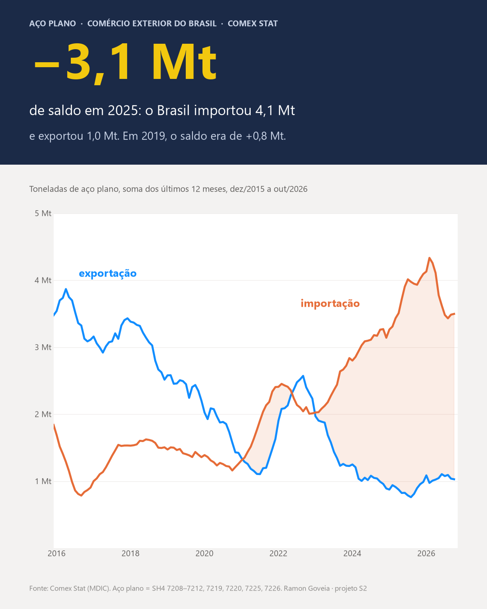

# O Brasil virou importador de aço plano

**Em 2025, o Brasil importou 4,1 milhões de toneladas de aço plano, 3,0 vezes o volume
de 2019, e exportou 1,0 milhão. O saldo foi de +0,8 milhão de toneladas em 2019 para
−3,1 milhões em 2025. Em 2026 (janeiro a outubro), a importação caiu 17%, mas a origem
mudou: a China foi de 69% para 42% do volume, e o Vietnã de 1% para 16%.**

**[→ Abrir o painel Aço e Minério no Comércio Exterior](https://goveiadev.github.io/s2-aco-minerio-comercio-exterior/painel/)**.
Abre no período corrente (o ano até o último mês publicado). Escolha produto, fluxo e período, incluindo os últimos 12 meses. Busque um país ou use **Ver todos**; selecione seu nome com mouse, Enter ou Espaço para filtrar volumes, valores, saldo e séries.
O país ativo fica indicado no topo. Pauta, estados, ranking e participações continuam como referência nacional, com o escopo identificado. No celular, saldo, volume e preço aparecem primeiro; **Mais indicadores** revela os outros cartões.



## A pergunta

**Que produtos de aço, minério e alumínio o Brasil está vendendo e comprando lá fora, de
onde, para onde e a que preço? E quanto aço importado está entrando?** É a leitura
mensal de quem vende para siderúrgicas, mineradoras e para a indústria que consome aço:
o volume que sai mostra a força do produtor brasileiro lá fora, e o que entra mostra a
concorrência que ele enfrenta aqui dentro.

## Os dados

- **[Comex Stat](https://comexstat.mdic.gov.br/)**, do Ministério do Desenvolvimento,
  Indústria, Comércio e Serviços (MDIC), pela
  [API oficial](https://api-comexstat.mdic.gov.br/docs). Exportação e importação mensal
  de janeiro de 2015 a outubro de 2026, em US$ FOB e quilos líquidos.
- 30 posições do Sistema Harmonizado (SH4), por país (148 mil linhas) e por estado
  (65 mil linhas). Baixadas por `baixar_dados.py`.
- Agrupadas em 9 produtos:
  - minério de ferro, ferro-gusa, ferroligas e semiacabados;
  - aço plano (7208–7212, 7219, 7220, 7225, 7226), aço longo (7213–7217, 7221, 7222, 7227, 7228) e tubos (7304–7306);
  - alumínio bruto e alumínio laminado e extrudado.

## O que eu fiz

1. Somei volume e valor por produto, fluxo, país, estado e mês.
2. **Saldo** = toneladas exportadas − importadas do mesmo produto.
3. **Preço médio** = valor FOB ÷ toneladas.
4. Para comparar com 2026, que vai até outubro, uso sempre **janeiro a outubro** dos dois
   anos.
5. O painel recalcula tudo no navegador a partir dos dados exportados pelo notebook. Nenhum
   número é digitado à mão.
6. A exportação preserva as frações de tonelada e de mil US$ da base; o arredondamento
   ocorre apenas na apresentação. Participações positivas abaixo de 1% aparecem como `<1%`.
7. O primeiro ano da série mostra **sem base anterior**. **Novo** significa volume
   positivo no período atual e zero no período anterior disponível, não a primeira
   operação histórica do país.

**Aço plano, ano inteiro:**

| Ano | Exportou | Importou | Saldo | US$/t exportado | US$/t importado |
|---|---|---|---|---|---|
| 2015 | 3,5 Mt | 1,8 Mt | +1,6 Mt | 549 | 794 |
| 2019 | 2,2 Mt | 1,4 Mt | +0,8 Mt | 645 | 901 |
| 2023 | 1,2 Mt | 2,8 Mt | −1,6 Mt | 1.109 | 997 |
| 2024 | 0,9 Mt | 3,1 Mt | −2,2 Mt | 999 | 866 |
| 2025 | 1,0 Mt | 4,1 Mt | −3,1 Mt | 891 | 789 |

**De onde vem o aço plano importado (janeiro a outubro):**

| | 2019 | 2024 | 2025 | 2026 |
|---|---|---|---|---|
| Volume | 1,21 Mt | 2,71 Mt | 3,50 Mt | 2,91 Mt |
| China | 53% | 81% | 69% | 42% |
| Coreia do Sul | 12% | 6% | 16% | 18% |
| Vietnã | 0% | 1% | 1% | 16% |

Em 2025, a tonelada chinesa entrou a US$ 694 FOB, contra US$ 1.016 da média das outras
origens.

## O que isso significa

**Para quem vende à siderurgia, o mercado mudou de lado.** Em 2019, o Brasil vendia mais
aço plano do que comprava. Em 2025, entrou 3,1 milhões de toneladas a mais do que saiu.
Cada tonelada importada que substitui produção local é volume a menos para a usina
brasileira e para a cadeia de serviço e logística em volta dela.

**2026 não é volta ao normal.** O volume importado caiu, mas segue mais que o dobro de
2019, e a origem se espalhou: Coreia do Sul e Vietnã passaram a responder por um terço. Quem
acompanha só a China vê uma queda que o total não confirma.

**O importado chega mais barato.** Desde 2023, o preço médio FOB do aço plano importado
fica abaixo do exportado. O FOB não tem frete nem imposto, então a diferença no preço
posto na fábrica é menor. Mesmo assim, a direção mostra de onde vem a pressão de preço.

## Limitações

- **O dado mostra o quê, não o porquê.** A queda de 2026 e a troca de origem coincidem
  com medidas de defesa comercial, câmbio e preço internacional. Esta base sozinha não
  separa as causas.
- **FOB não é o preço posto na fábrica.** No importado faltam frete, seguro, imposto de
  importação, AFRMM e internação.
- **Mistura de produto.** "Aço plano" junta bobina a quente, a frio, galvanizado e inox,
  com preços muito diferentes. O preço médio do grupo muda com a mistura, mesmo sem
  mudar o preço de nenhum item.
- **Origem declarada.** Aço laminado ou revestido num terceiro país aparece com a origem
  desse país. Isso importa para ler a troca da China pelo Vietnã.
- **Estado é a UF do produto:** produtor na exportação, domicílio do importador na
  importação. Não é onde o aço é consumido. Santa Catarina lidera a importação (39% em 2025), o
  que reflete onde estão os importadores, não necessariamente onde o aço é usado.
- **Comércio exterior não é consumo aparente.** Para saber a fatia do importado no
  mercado brasileiro faltam produção e vendas internas (Aço Brasil), que não estão nesta
  base.
- **2026 vai até outubro** e os meses mais recentes podem ser revisados pelo MDIC.

## Atualização

O painel se atualiza sozinho. Toda segunda-feira, um GitHub Actions
(`.github/workflows/atualizar.yml`):

1. pergunta à API do Comex Stat qual é o último mês publicado;
2. baixa a série toda de novo, com `baixar_dados.py` (o MDIC revisa meses recentes);
3. gera `painel/dados.js`, com `exportar.py`;
4. publica só se algo mudou.

O topo do painel mostra até que mês vão os dados e a data da última atualização.
Para forçar a atualização: aba Actions → "Atualizar dados do Comex Stat" → Run workflow.

## Como rodar

Execute na pasta deste projeto. Para gerar o painel no Windows (Python 3.14):

```powershell
python -m venv .venv
.venv/Scripts/python -m pip install -r requirements.txt
.venv/Scripts/python baixar_dados.py dados
.venv/Scripts/python exportar.py
.venv/Scripts/python -m http.server 8000 --bind 127.0.0.1
```

A coleta cria a pasta `dados` automaticamente. Abra `http://127.0.0.1:8000/painel/`.
Para visualizar a base já versionada, basta iniciar o servidor; não é necessário instalar
dependências ou baixar os CSVs novamente. No Linux/macOS, troque `.venv/Scripts/python`
por `.venv/bin/python`.

Notebook e capa são opcionais:

```powershell
.venv/Scripts/python -m pip install -r requirements-analise.txt
.venv/Scripts/python -m jupyter nbconvert --to notebook --execute --inplace analise.ipynb
.venv/Scripts/python capa.py
```

O notebook chama o mesmo `exportar.py` da atualização automática.

## Verificação

```powershell
.venv/Scripts/python -m unittest discover -s tests -v
node --check painel/app.js
```

Os testes verificam precisão em operações pequenas, agregação de SH4, preço ponderado,
exportação sem mudanças e criação da pasta de coleta. A API é simulada nesses testes.
Na interface, conferir 2015 sem base anterior, busca fora dos 20 maiores, seleção e
limpeza de país por teclado, escopo nacional, modo mensal e layout a 390 e 1440 pixels.

---
Ramon Goveia · [linkedin.com/in/ramon-goveia-92266443](https://www.linkedin.com/in/ramon-goveia-92266443) · projeto S2 · dados aplicados ao mercado da indústria pesada
